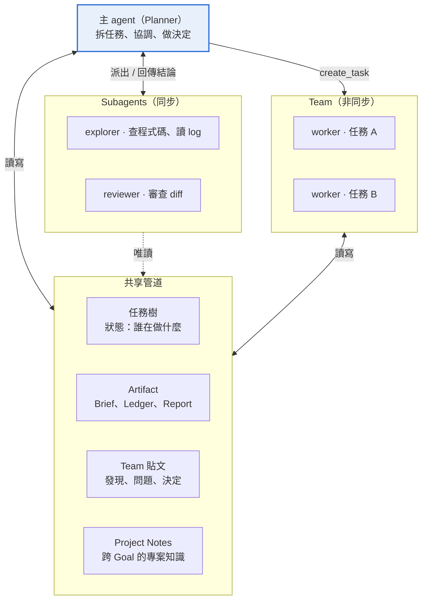

# Agent Loop 與協作模型

[← 產品提案索引](product.md)

## 統一 Agent Loop 與協作模型

所有 agent 共用同一個 loop。對話 agent、Planner、worker、總管與 subagent 的差別只在 profile：拿到哪些工具、用哪個模型、記憶怎麼接。唯讀工具每個 profile 都有。

### 一個 loop

每次執行都是同一個函式：組 context、跑 rig 的多輪工具迴圈、由平台的 gate 在每次工具呼叫前後把關、寫回結果。

```rust
pub struct AgentProfile {
    pub name: ProfileName,          // chat | planner | worker | global | explorer | reviewer
    pub model: ModelRef,
    pub role_prompt: String,
    pub extra_tools: Vec<ToolName>, // 唯讀基礎集之外的授權
    pub memory: MemoryMode,         // Om { conv } | Stateless
    pub spawn: SpawnRights,         // 能否開 subagent、能否建立 team 任務
    pub max_turns: usize,
}
pub enum ToolClass {
    Read,    // 所有 profile 都有
    Write,   // 改平台狀態或 worktree
    Spawn,   // 開 subagent 或 team 任務
    Suspend, // wait_for、schedule：執行後結束本輪
    Effect,  // 對外副作用：自動轉成核准請求
}
pub async fn run_agent(
    p: &AgentProfile,
    scope: Scope,      // Project | Goal | Task | Global
    trigger: Trigger,
    b: &Backends,
) -> Result<RunOutcome> {
    let ctx   = assemble_context(p, &scope, &trigger, b).await?;
    let tools = b.registry.toolset(READ_BASE.iter().chain(&p.extra_tools),&scope);
    let gate  = Gate::new(p, &scope, b.budget_for(&scope));
    let agent = llm::agent(&p.model)
        .preamble(&ctx.preamble)
        .tools(tools)
        .hook(gate.clone())
        .default_max_turns(p.max_turns)
        .build();
    let reply = match &p.memory {
        MemoryMode::Om { conv } => agent.prompt(ctx.trigger_msg).conversation(conv.as_str()).await?,
        MemoryMode::Stateless   => agent.prompt(ctx.trigger_msg).await?,
    };
    Ok(gate.finish(reply)) // Done | Suspended | NeedsApproval | Cancelled
}
```

Gate 是 rig 的 `PromptHook` ，負責所有「不能靠 prompt」的規則：

- 授權。 工具不在 profile 內就拒絕；scope 也在這裡檢查，例如 worker 只能讀寫自己的 worktree。

- 預算與取消。 每輪開始前檢查預算與 cancel、steer 事件，有就乾淨結束。

- 工具類別。 Suspend 類執行後結束本輪；Effect 類不執行，改建核准請求後結束本輪。

- 追蹤。 每次呼叫寫進 trace。

外部 coding CLI 用自己的 loop，是唯一的例外；但它拿到的平台工具一樣由 worker profile 決定，透過 MCP 提供，gate 規則在 MCP server 端執行。

### Profile 一覽

| Profile | 記憶 | 唯讀基礎集之外的工具 | 可開 |
| --- | --- | --- | --- |
| chat | OM（project 對話） | `create_goal` 、`steer_goal` 、 `cancel_goal` 、`quick_fix` 、 `write_artifact` （Spec）、 `propose_user_md_edit` 、 `propose_project_note` 、 `schedule` 、`create_listener` | subagent |

| Profile | 記憶 | 唯讀基礎集之外的工具 | 可開 |
| --- | --- | --- | --- |
| planner | 無狀態（讀 Brief、 Ledger、任務樹） | `create_task` 、`cancel_task` 、 `post_to_team` 、 `request_approval` 、 `post_milestone` 、`escalate` 、 `complete_goal` 、`write_artifact` （Ledger）、 `propose_project_note` 、`schedule` | subagent、 team 任務 |
| worker | 無狀態（讀任務 thread） | `edit_file` 、`run` 、`open_pr` 、 `wait_for` 、`post_to_team` 、 `report_progress` 、 `complete_task` 、`fail_task` 、 `escalate` 、`write_artifact` （Report） | 唯讀 subagent |
| global | OM（全域對話） | `create_goal` （任一 project）、 `archive_goal` 、 `pause_automations` | subagent |
| explorer | 無狀態 | 無 | 不可 |
| reviewer | 無狀態 | 無（只回傳審查意見） | 不可 |

Profile 存成設定檔（例如 `profiles/*.toml` ），新增一種 agent 只需新增一個檔案，不用改程式碼。

### 唯讀基礎工具

每個 profile 都有，查詢範圍受 scope 限制：

- 平台狀態：`get_status` 、`list_goals` 、`read_artifact` 、`read_team` 、`read_run` （其他 run 的摘要與 trace）

- 歷史：`recall` （自己的原始歷史）、`search_history` （scope 內的對話、artifact、 team 貼文）

- 程式碼：`list_files` 、`read_file` 、`grep` 、`git_log` 、`git_diff`

- 外部來源：`get_change` （PR 或 MR）、`get_ci_log` 、`search_mail` 、`read_mail` 、 `get_source_status` ；實際有哪些，由 project 啟用的 connector 決定

worker 讀自己的 worktree；其他 profile 讀的是每個 repo 預設分支的唯讀鏡像，由平台定期 fetch。

### 工作分級：小修改怎麼分配

對話 agent 收到請求後先分級，小修改走不經 Planner 的快速通道。

| 等級 | 例子 | 處理方式 | 留下的紀錄 |
| --- | --- | --- | --- |
| 回答 | 「這個函式在哪裡用到？」「CI 為什麼掛？」 | 對話 agent 用唯讀工具自己查，或開 explorer subagent | 只在對話中 |
| 快速修改 | 改錯字、調設定、單一檔案的小 bug | `quick_fix` 直接派一個 worker，不經 Planner、不寫 Brief | 一個 Quick Goal 加一個任務 |
| 功能 | 新功能、跨模組重構 | `create_goal` ，Planner 拆任務交給 team | 完整 Goal、 Brief、Ledger |

1. `quick_fix` 只帶一段描述與目標 repo。平台建立 kind 為 Quick 的 Goal 與單一任務，對話裡出現一張精簡卡片。

2. worker 照常在容器與 worktree 裡修改、開 PR、等 CI；merge 一樣要核准。

3. 快速通道有範圍上限：預設改動不超過 5 個檔案、200 行，且不需要設計決定。worker 發現超出時呼叫 `escalate` ，平台把它升級成一般 Goal、補建 Brief 交給 Planner；已做的修改留在分支上。

4. 同一個 repo 同時有多個快速修改時各自開 PR，不合併，方便逐一核准與回退。

5. 輸入框旁可以直接選「快速修改」或「開 Goal」，覆蓋對話 agent 的判斷。

### 主 agent、subagent 與 team



協作模型 · 主 agent、subagent、team 與共享管道

|  | 主 agent | Subagent | Team 成員 |
| --- | --- | --- | --- |
| 是誰 | 擁有對話或 Goal 的 agent：chat、planner、 global | 主 agent 在一輪內開出的臨時助手 | Planner 用 `create_task` 建立的 worker |
| 生命週期 | 永久（對話）或跟著 Goal | 單次 run，回傳結果即結束 | 跟著任務，可掛起、喚醒、跨好幾天 |
| 同步性 | — | 同步：主 agent 等它回來，可並行多個 | 非同步：透過任務樹與事件 |
| context | 自己的記憶或 Brief | 只有主 agent 給的說明 | 任務描述、Brief、 team 貼文 |
| 能做什麼 | 依 profile | 預設唯讀（explorer、 reviewer） | 依 worker profile，可寫入 |
| 結果去哪 | 對話或 artifact | 只回到主 agent 的 context | 任務結果、Report、 team 貼文 |

|  | 主 agent | Subagent | Team 成員 |
| --- | --- | --- | --- |
| 平台紀錄 | `agent_runs` | 子 run （`parent_run_id` ），不建任務 | `tasks` 與 `agent_runs` |

- subagent 是用來保持主 agent 的 context 乾淨。 讀大量程式碼、整理 CI log、審查 diff，把結論帶回來；主 agent 收到的是結論，不是過程。

- 上限。 subagent 不能再開 subagent（深度 1），每輪最多並行 4 個，預算從主 agent 的 run 扣。

- 何時改用 team。 需要寫入、需要等外部事件、或要跨超過一輪的工作，一律不用 subagent，改成 team 任務。

- team 成員不直接對話。 只透過下面的管道交換資訊，由 Planner 協調。

### 資訊分享管道

| 管道 | 內容 | 誰寫 | 誰讀 | 特性 |
| --- | --- | --- | --- | --- |
| 任務樹 | 狀態：誰在做什麼、卡在哪 | 平台（依工具呼叫） | 所有人 | 唯一真相，用 `get_status` 讀 |
| Artifact | 長篇共享知識： Spec、Brief、 Ledger、Report | 依 profile | 所有人 | 有版本，你可直接編輯 |
| Team 貼文 | Goal 內的短訊：發現、問題、決定、阻礙 | Planner、 worker | 同一 Goal 的成員 | 有型別、只增不改 |
| Subagent 回傳 | 單次查詢的結論 | subagent | 只有開它的主 agent | 私有，不落地 |
| Project Notes | 跨 Goal 的專案知識：怎麼跑測試、踩過的坑 | agent 提案，你核准 | 所有 profile（放在 preamble） | USER.md 的 project 版 |

```rust
pub enum TeamPost {
    Finding  { text: String },                     // 例：「auth 測試要先起 redis」
    Question { to: Option<TaskId>, text: String }, // 沒有 to 就是問 Planner
    Decision { text: String },                     // 只有 Planner 能發
    Blocker  { text: String },
    Handoff  { to: TaskId, text: String },
}
```

- 投遞。 成員每輪開始時收到「上次之後的新貼文」。只有 Question 與 Blocker 會喚醒 Planner，Handoff 會喚醒被交接的任務，Finding 不喚醒任何人。

- 防迴圈。 worker 的問題一律由 Planner 回答（Decision），worker 不會因為其他 worker 的貼文被喚醒；同一個 Goal 的貼文有速率上限。

- 沉澱。 Goal 結束時，Planner 把有長期價值的 Finding 整理成 Project Notes 提案。

- 和對話的關係。 team 貼文不進 OM，對話裡只看得到 Planner 轉出的里程碑；你想看細節時在 Goal 的狀態面板裡看。

