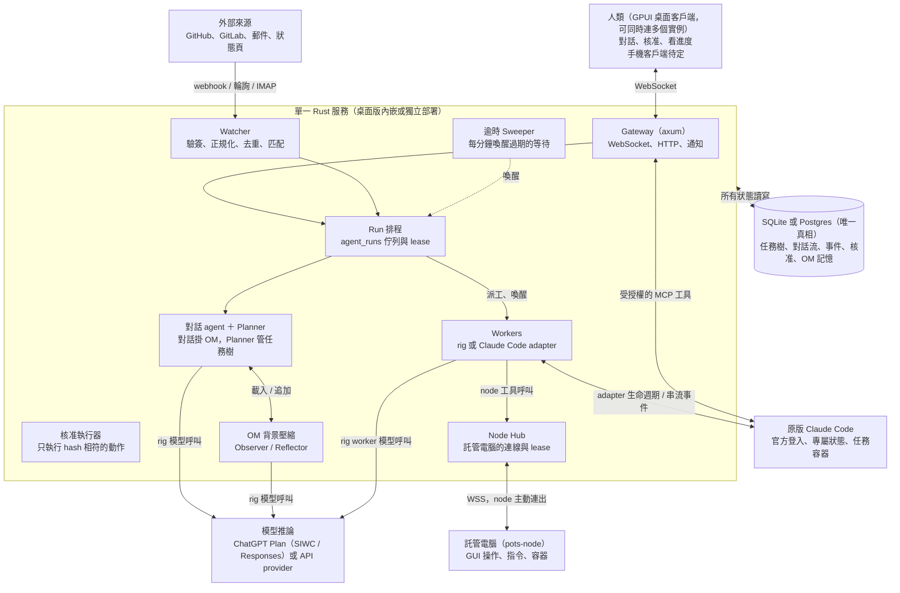

# 系統架構與資料模型

[← 產品提案索引](product.md)

## 系統架構總覽

整個平台是一個 Rust 服務加 SQLite 或 Postgres。桌面版由桌面 app 內嵌這個服務，多設備版則獨立部署。下圖是一個實例的內部，客戶端可以同時連好幾個這樣的實例（見[多實例並存](deployment.md#多實例並存)）。人類訊息經 Gateway、外部事件經 Watcher 進入，全部變成 `agent_runs` 佇列裡的工作，再由 Run 排程交給對話 agent、Planner 或 worker。



系統架構 · 單一服務加 SQLite 或 Postgres

ChatGPT Plan provider 只處理 pots 自有 rig loop 的推論；Claude Code adapter 接入另一個完整 agent runtime，兩者不是同一種 provider。ChatGPT 授權由 pots 的受保護憑證層管理，Claude 登入由官方 CLI 管理；Codex 不在本次整合範圍。詳見[Agent 執行層](agent-runtime.md)。

agent 之間不直接互相呼叫：它們只透過工具讀寫資料庫中的任務樹，由排程器決定下一個跑誰。核准後的 merge 等動作由核准執行器呼叫 GitHub，不經過 agent。

## 核心資料模型

Goal 與 Task 構成任務樹，是平台唯一的真相來源；對話流（StreamItem）、agent 的記憶（OM）、外部事件各自獨立存放。ID 一律用 UUIDv7，時間有序，分頁直接用 `before=<id>` 。

### 型別

```rust
pub enum Principal { Human(UserId), Agent(AgentId), System }
pub enum TaskState {
    Planned,
    Running    { run: RunId, lease_until: Timestamp },
    Waiting    { on: WaitCond, deadline: Timestamp },
    NeedsHuman(Escalation),
    Done(Outcome),
    Failed     { attempts: u8, error: String },
    Cancelled  { by: Principal },
}
pub enum WaitCond {
    CiFinished  { repo: RepoId, sha: Sha },
    ChangeReviewed { change: ChangeRef },  // PR 或 MR
    ChangeMerged   { change: ChangeRef },
    Resource       { key: ResourceKey, kinds: KindSet }, // 任何來源的通用等待
    Subtasks(Vec<TaskId>),
    At(Timestamp),                 // 自我排程的單次喚醒
    Approval(ApprovalId),
}
pub enum StreamItem {
    Human(Msg),
    Agent(Msg),               // 可串流：status = streaming | done | failed
    Card(Card),
    Event(EventRef),          // 只給人看，不進 OM
}
pub enum Card {
    GoalCreated { goal: GoalId },
    Milestone   { goal: GoalId, text: String },
    Approval    { id: ApprovalId },
    CatchUp     { since: Timestamp, summary: String },
    Artifact    { id: ArtifactId, change: ArtifactChange }, // 建立或重大更新
    Triggered   { listener: ListenerId, goal: GoalId },     // listener 自動開工
}
pub enum MemoryPolicy { Observe, ObserveOutcome, Skip }
pub fn memory_policy(item: &StreamItem) -> MemoryPolicy {
    match item {
        StreamItem::Human(_) | StreamItem::Agent(_)       => MemoryPolicy::Observe,
        StreamItem::Card(Card::Approval { .. })           => MemoryPolicy::ObserveOutcome,
        StreamItem::Card(Card::CatchUp { .. })            => MemoryPolicy::Skip,
        StreamItem::Card(_)                               => MemoryPolicy::Observe,
        StreamItem::Event(_)                              => MemoryPolicy::Skip,
    }
}
```

### 資料表（SQLite 與 Postgres 共用）

| 表 | 用途 | 關鍵欄位 |
| --- | --- | --- |
| `instance` | 本實例的永久身分（只有一列） | `id` , `name` , `created_at` |
| `projects` | 一個 project 對應一個對話 agent 與一條對話 | `id` , `name` , `instructions` , `repos[]` , `budget` , `residency` （`active` ｜ `moving` ｜ `moved`） |
| `project_transfers` | project 移交紀錄（移出、移入、取回） | `id` , `project_id` , `direction` , `peer_instance` , `peer_url` , `state` , `at` |
| `client_devices` | 客戶端裝置 token，可撤銷 | `id` , `user_id` , `name` , `token_hash` , `last_seen` , `revoked_at` |
| `stream_items` | UI 顯示的完整對話流 | `id` , `project_id` , `thread_of` , `author` , `kind` , `body jsonb` , `status` |
| `goals` | 人類意圖的根節點 | `id` , `project_id` , `title` , `state` , `brief, budget_tokens` , `spent_tokens` |
| `tasks` | 任務樹節點 | `id` , `goal_id` , `parent_id` , `assignee` , `state jsonb` , `attempts` , `spent_tokens` |
| `task_events` | 任務狀態變化的只增日誌（稽核與重播） | `task_id` , `seq` , `from` , `to` , `cause` |
| `agent_runs` | agent 執行佇列（`FOR UPDATE SKIP LOCKED` ） | `id` , `agent` , `task_id?` , `trigger` , `state` , `lease_until` |
| `model_connections` | 模型授權連線的非秘密 metadata | `id, user_id, kind, issuer, subject, client_id, host_id, scopes, status, secret_ref` |
| `worker_sessions` | 外部 runtime 的續接與 run 對應 | `id, user_id, task_id, run_id, backend, external_session_id, state_ref, worktree_ref` |
| `nodes` | 託管電腦的註冊、能力、政策與狀態 | `id, user_id, name, os, capabilities, pubkey, policy, status, last_seen` |
| `node_leases` | node 的 display 等資源由誰持有 | `node_id, resource, holder, until` |
| `run_media` | 截圖等二進位證據（存在檔案儲存區） | `id, run_id, kind, sha256, path, at` |
| `subscriptions` | 任務訂閱的外部資源 | `task_id` , `resource_key` （如 `gh:owner/repo@sha` ） |

| 表 | 用途 | 關鍵欄位 |
| --- | --- | --- |
| `external_events` | 正規化後的外部事件 | `id` , `dedupe_key unique` , `kind` , `payload` , `matched_tasks[]` |
| `approvals` | 核准請求 | `id` , `task_id` , `action jsonb` , `action_hash` , `state` , `expires_at` , `decided_by` |
| `om_raw` | rig 寫入的原始訊息（含工具呼叫） | `project_id` , `seq` , `message jsonb` , `tokens` , `observed bool` |
| `om_observations` | Observer 產出的觀察 | `project_id` , `generation` , `seq` , `date` , `priority` , `text` , `pinned` |
| `push_subscriptions` | Web Push 訂閱（候選方案，推播方式待定） | `user_id` , `endpoint` , `p256dh` , `auth` |
| `artifacts` | 人與 agent 共同編輯的文件（spec、brief、ledger、 report） | `id, project_id, goal_id?, kind, title, rev, body_md` |
| `artifact_revisions` | 每次修改的版本與作者，用於 diff 與還原 | `artifact_id, rev, author, body_md, at` |
| `schedules` | agent 自己設定的單次或週期喚醒 | `id, owner, spec, prompt, next_at, expires_at, enabled` |
| `listeners` | 符合條件的外部事件自動開 Goal 的規則 | `id, project_id, filter, action, budget_per_trigger, max_per_hour, enabled` |
| `team_posts` | Goal 內 team 成員的短訊（發現、問題、決定、阻礙、交接） | `id, goal_id, author_task?, kind, to_task?, body, at` |
| `sources` | 外部來源的設定、輪詢進度與健康狀態 | `id, kind, config, trust, ingest, cursor, health, enabled` |

`model_connections` 不儲存 OAuth token 或 API key；`secret_ref` 指向受保護憑證層，host ID 依持久執行環境保存。`worker_sessions.state_ref` 指向官方 session 儲存，不是 Claude token 匯入欄位。以上為待實作的概念 schema，帳號／workspace 註冊與 user 所有權須隔離。

`stream_items` 給人看，`om_raw` 給 agent 用，兩者以 `run_id` 關聯。這樣 UI 可以保留完整歷史，OM 也可以自由壓縮，互不干擾。

## Crate 選型

大多是成熟、維護中的 crate。需要特別管理版本的是 rig，以及仍在預發布階段的 GPUI 相關 crate。

| 領域 | Crate | 備註 |
| --- | --- | --- |
| 非同步執行期 | `tokio` |  |
| HTTP / WebSocket | `axum` （`ws` feature） | 客戶端的即時協定與 HTTP API |
| 資料庫 | `sqlx` （SQLite、Postgres） | 依設定選用 SQLite 或 Postgres，兩個 feature 都開；編譯期檢查 SQL，內建 migration |
| LLM 與 agent | `rig-core` | 釘精確版本；`llm` 模組封裝 ChatGPT Plan Responses 相容層與 API provider |
| 記憶策略（選用） | `rig-memory` | 只參考其介面，OM 自己實作 |
| JSON Schema | `schemars` | 工具參數定義 |
| GitHub API | `octocrab` | GitHub App 認證與 REST |
| Webhook 驗簽 | `hmac` + `sha2` |  |
| Web Push | `web-push` | VAPID；手機推播候選方案 |
| 登入 | `webauthn-rs` | passkey |
| ID | `uuid` （v7） | 時間有序 |
| 可觀測性 | `tracing` 、`tracing-opentelemetry` |  |

| 領域 | Crate | 備註 |
| --- | --- | --- |
| 桌面客戶端 | `gpui-kit` （GPUI） | GPUI 為預發布版，釘精確版本；需較新的 Rust 編譯器 |
| Artifact 編輯器 | `gpui-kit-markdown-editor` | 區塊式所見即所得 Markdown；0.1.x，釘精確版本 |
| MCP | `rmcp` | M4 供 Claude Code adapter 存取平台工具，伺服器端執行授權 |
| Git 操作 | `tokio::process` 呼叫 `git` | worktree 等操作直接用 CLI 最穩 |
| 桌面通知 | `notify-rust` | macOS、Linux、Windows 原生通知；桌面版由服務發出，遠端實例的通知由已連線的客戶端顯示 |
| 憑證儲存（桌面版與客戶端） | `keyring` | API key、ChatGPT SIWC 憑證與遠端實例的裝置 token；不接管 Claude CLI 登入 |
| 排程 | `croner` | 解析 cron 字串、計算下一次觸發 |
| Artifact diff | `similar` | 產生「人類修改」的文字 diff |
| GitLab API | `reqwest` | 直接呼叫 REST，涵蓋自架實例 |
| 收信 | `async-imap` 、`mail-parser` | IMAP IDLE 長連線與郵件解析 |
| 寄信 | `lettre` | SMTP，核准後才由平台寄出 |
| RSS／Atom | `feed-rs` | 狀態頁與公告 feed |
| macOS 系統 API（pots-node） | `objc2` 系列 binding | ScreenCaptureKit 擷取螢幕、Accessibility（AX）樹、CGEvent 輸入事件 |
| Node 身分 | `ed25519-dalek` | 配對與連線 challenge 簽章 |

