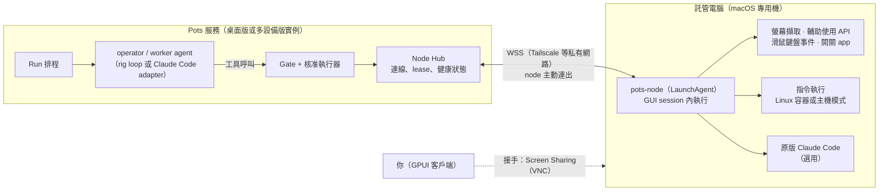

# 託管電腦（Node）

[← 產品提案索引](product.md)

## 概念：把閒置的電腦交給 Pots

你把一台閒置的電腦交給 Pots，它就成為 agent 的「身體」：agent 能看螢幕、操作滑鼠鍵盤、開桌面應用程式、執行指令與寫程式。Pots 服務本身不跑在這台電腦上，而是在這台電腦安裝一個小型常駐程式 `pots-node`，由它主動連回 Pots，接收並執行指令。

這和 Grok Bot、ChatGPT dots 的「agent 有自己的雲端電腦」是同一個概念，差別在於硬體是你自己的、可以整台清空重灌，平台與資料都在你手上。

### 範圍（v1）

- **一台 macOS 專用機。** 機器上沒有你的個人資料，也不登入你的個人帳號；壞了就依[佈建流程](#佈建macos-專用機)重灌。
- **兩種用途。** 操作 GUI 桌面應用程式（computer use），以及開發與 coding（把現有 worker 改到這台機器上執行）。
- **非目標。** 讓 agent 管理這台電腦本身（系統更新、備份、服務管理）、在機器上登入你的個人帳號替你操作網站、同時有多個 GUI 任務、支援 Windows 與 Linux 桌面。資料模型保留 `os` 欄位，以後再擴充。

### 和既有設計的關係

- **Node 是執行位置，不是新的 agent。** 誰來規劃、誰來核准都不變；任務仍由 Planner 用 `create_task` 建立，只是 worker 的執行位置從「Pots 主機上的容器」變成「某台 node」。
- **任務樹仍是唯一真相。** Node 上不保存任何只有它才有的狀態：程式碼改動推到任務分支，截圖與紀錄回傳 Pots，產出寫成 artifact。整台 node 隨時可以清空。
- **Pots 必須在線。** Node 自己不跑模型、不做決定；Pots 停止時（例如桌面版所在的筆電睡眠），node 只會閒置等待。若要 24 小時不停，node 就要配對到跑在常開機器上的實例（見[部署](deployment.md)）。
- **一台 node 只配對一個實例。** 桌面版和多設備版並存時，每台 node 只屬於其中一個實例，display lease 才不會被兩個實例同時搶用。要換實例就先解除配對再重新配對；project 移交時不會帶走 node。

## 架構



- **連線方向。** 由 node 主動連出到 Pots 的 WebSocket，不必在 node 開任何對外的 port，NAT 後面也能用。網路走 Tailscale 等私有網路。桌面版要在該私有網路介面上開啟 [node 專用 listener](deployment.md#桌面版app-內嵌服務)，它只接受 node 簽章連線，不對公網開放，也不提供客戶端 API。
- **Node Hub。** Pots 內的新模組，管理 node 的註冊、連線、心跳、lease 與指令轉送。agent 的工具呼叫經過 Gate 之後，才由 Hub 轉成 node 指令。
- **pots-node。** Rust 寫成的 daemon，以 LaunchAgent 跑在 node 已登入的 GUI session 裡；擷取螢幕與送出輸入事件都必須在 GUI session 內，LaunchDaemon 做不到。另有一個小型 LaunchDaemon 當看門狗，負責重啟與回報健康狀態。

### 配對與身分

1. 在 Pots 客戶端的「電腦」頁按「新增電腦」，取得一次性配對碼（10 分鐘內有效）。
2. 在 node 上執行 `pots-node enroll <pots-url> <code>`。node 產生 Ed25519 金鑰對，私鑰存在 node 的 keychain，Pots 只保存公鑰。
3. 往後每次連線都由 node 簽署 Pots 給的 challenge；Pots 端以釘選的憑證或私有網路的 TLS 驗證身分。
4. 在 Pots 移除 node 就會撤銷公鑰，node 立刻斷線。重灌後要重新配對。

Node 上不存放任何模型憑證：截圖與畫面資訊回傳 Pots，由 Pots 呼叫模型。唯一例外是選用的 Claude Code，它照官方方式在 node 上登入（見[Coding 任務](#coding-任務)）。

## 能力與工具

### operator profile

新增一種 profile：`operator`，也就是操作電腦的 worker。它是無狀態的（讀任務 thread），擁有 worker 的基本工具，外加下列 node 工具。一般 coding worker 指定在 node 上執行時，只會拿到 `node_run` 與檔案工具，沒有 GUI 工具。

| 工具 | 類別 | 說明 |
| --- | --- | --- |
| `screen_observe` | Read | 截圖，加上前景 app、視窗清單與輔助使用（AX）樹的精簡結構；回傳元素 ID 供後續操作 |
| `ui_act` | Write | 點擊、輸入文字、按鍵組合、捲動、拖曳；目標優先用 AX 元素 ID，找不到才用座標 |
| `wait_ui` | Write | 短暫等待某個元素出現或消失（上限 60 秒），不是 Suspend，不結束本輪 |
| `app_open`、`app_quit` | Write | 開關 profile 允許清單內的 app |
| `node_run` | Write | 在任務容器或主機模式（見下）執行指令 |
| `node_file_get`、`node_file_put` | Write | 在 Pots 和 node 之間搬檔案，限定在任務工作目錄內 |
| `gui_checkpoint` | Effect | 要做不可逆或對外的 GUI 操作前，建立核准請求；核准後由平台執行（見[核准](#核准與-gui-的副作用)） |

設計重點：

- **結構化資訊優先，截圖其次。** 每次觀察都盡量附上 AX 樹，讓模型用元素 ID 操作，比只看像素可靠也便宜；AX 資訊不完整的 app（部分 Electron、遊戲、畫布型 app）才退回座標操作。
- **每一步都留下證據。** 每次 `ui_act` 前後各存一張截圖，寫進 trace 與 `run_media`，在「為什麼」面板可以逐步回放。
- **模型需求。** operator 必須用支援影像輸入與工具呼叫的模型。Pots 以一般 function tool 加影像輸入實作，不依賴任何 provider 的 hosted computer-use 工具，因此 rig 的各個 provider 都能用；ChatGPT Plan provider 在 SIWC preview 下是否支援影像輸入，必須實測確認。
- **Claude Code 也能用。** Claude Code 透過 Pots 的 MCP server 拿到同一組 node 工具，Gate 規則一樣在伺服器端執行。

### 一次只有一個 GUI 任務：display lease

一台 node 只有一個桌面，同時只能有一個 GUI 任務在操作。

```rust
pub enum NodeLeaseHolder {
    Run(RunId),      // operator 正在操作
    Human(UserId),   // 你接手中
}
pub struct NodeLease {
    node: NodeId,
    resource: NodeResource,  // v1 只有 Display
    holder: NodeLeaseHolder,
    until: Timestamp,        // 跟著心跳續約
}
// 新增等待條件：拿不到 display 時任務進入 Waiting
WaitCond::NodeDisplay { node: NodeId }
```

- operator 每一輪開始前先取得 display lease，拿不到就以 `WaitCond::NodeDisplay` 掛起，lease 釋放時再喚醒，不必另外設計佇列。
- coding 任務不需要 display，可以和 GUI 任務並行，上限由 node 設定的並行數決定。
- 你接手時 lease 交給 `Human`，agent 立刻停止送出輸入，等你按「交還」後才恢復。

### Coding 任務

Coding worker 可以指定在 node 上執行，分成兩種模式：

```rust
pub enum ExecTarget {
    PotsHost,                         // 既有做法：Pots 主機上的容器
    Node { node: NodeId, mode: NodeExec },
}
pub enum NodeExec {
    Container, // 預設：Podman machine 或 colima 裡的 Linux 容器，一個任務一個
    Host,      // 主機模式：直接在 node 的 macOS 上執行，給 Xcode 等原生工具鏈用
}
```

- **Container 模式**和現有的 worker 沙箱一樣：一個任務一個 worktree 加一個容器，預設不能連外網。macOS 上的容器跑在 Linux VM 裡，效能與檔案掛載行為必須實測。
- **Host 模式**由 project 設定明確開啟，只適合需要 macOS 原生工具鏈的任務。所有 host 模式的任務共用 node 的 `pots` 帳號，彼此之間只靠 worktree 目錄分隔；能接受這個風險，是因為機器是專用機、可以清空。
- **Claude Code** 在 node 上照官方方式登入一次，由 `pots-node` 啟動 `claude -p ... --output-format stream-json`，把輸出串流回 Pots 的 `OutputParser`。登入狀態只存在 node 上，不回傳 Pots。
- GitHub token 照舊是短效、只限該任務 repo 的 token，由 Pots 在任務開始時發給 node，任務結束就撤銷。

## 核准與 GUI 的副作用

Pots 的核准模型是「核准結構化動作，由平台執行」。GUI 操作沒有結構化參數，所以 v1 用兩層把關：

1. **硬邊界：機器上沒有可以對外代表你的帳號。** 這是範圍中「不登入個人帳號」的原因。在這個前提下，大部分 GUI 操作的影響只限於這台可以清空的機器，所以 `ui_act` 歸類為 Write，不需要核准。
2. **軟邊界：`gui_checkpoint`。** 如果之後替 node 綁定了帳號（例如專用的測試帳號），可以在 node 政策裡把 app 標成 `effectful`。agent 在 effectful app 裡做「送出、付款、刪除、發佈」這類操作前，必須呼叫 `gui_checkpoint`：

```rust
pub struct GuiCheckpoint {
    node: NodeId,
    app_bundle_id: String,
    window_title: String,
    element: AxElementRef,      // AX 路徑與角色
    action: UiAction,           // 例：Click、Type { text }
    screenshot_sha256: String,  // 核准卡片上顯示的那張截圖
    intent: String,             // agent 對這一步的說明，只供參考
}
```

核准卡片會顯示截圖、目標元素與 agent 的說明。核准後由 Hub 送出指令，`pots-node` 先檢查前景 app、視窗標題與 AX 元素都和核准時一致才執行，不一致就退回、要求 agent 重新申請。

**限制：** 這一層靠 agent 自己判斷「這一步有副作用」，agent 可能判斷錯誤，所以不能取代硬邊界。在沒有更強的機制之前，不建議在 node 上登入真實的個人帳號；要做也只限定專用帳號，並把該 app 標成 effectful。

| 動作 | 預設 | 說明 |
| --- | --- | --- |
| 一般 GUI 操作（`ui_act`） | 不用 | 前提是 node 上沒有可以代表你的帳號 |
| effectful app 內的送出／付款／刪除 | 要核准 | `gui_checkpoint`，執行前驗證畫面 |
| 開啟允許清單外的 app | 要核准 | 核准後可以選擇加入允許清單 |
| 主機模式執行指令 | 不用 | 須先由 project 設定開啟主機模式 |
| merge、部署、寄信 | 要核准 | 和既有規則相同，由平台執行，不經過 node |

## 人類接手

agent 常卡在只有人能處理的地方：權限對話框、驗證碼、兩步驟驗證、首次啟動精靈。

- **升級。** operator 呼叫 `escalate` 並附上 `NeedsHuman(GuiBlocked { screenshot })`，平台推播給你。
- **接手。** 卡片上的「接手」按鈕會把 display lease 交給你，並開啟 macOS 內建的 Screen Sharing（`vnc://` 走私有網路）。內建 Screen Sharing 是系統服務，即使 `pots-node` 的螢幕錄製權限失效也能使用，同時是修復 node 的後門。
- **交還。** 你按「交還」或關掉連線 5 分鐘後，lease 自動交回 agent；agent 下一輪會先重新觀察畫面再繼續。
- **緊急停止。** Pots 客戶端與 node 頁面都有「停止」：撤銷 lease、停止所有輸入、結束該 node 上所有任務的子程序。node 斷線超過 30 秒時，`pots-node` 也會自動停止送出輸入。

## 健康狀態與事件

Node 接入既有的[事件管線](events-and-automation.md)，成為一種 `SourceConnector`（`kind = Node`，trust 為 `Owned`）：

| 事件 | 觸發條件 | 預設處理 |
| --- | --- | --- |
| `NodeOffline`、`NodeOnline` | 心跳逾時 60 秒、恢復連線 | 推播；GUI 任務轉為 Waiting |
| `PermissionLost` | 螢幕錄製或輔助使用權限被撤銷，或出現定期重新授權的提示 | 推播並附上「接手」 |
| `ResourceLow` | 磁碟剩餘 < 10%、記憶體壓力持續偏高 | 通知對話 agent |
| `DisplayMissing` | 偵測不到可用的顯示器（假螢幕脫落等） | 推播 |

狀態面板新增「電腦」分頁，列出 node 的連線狀態、目前的 lease 持有者、即時縮圖（每 10 秒一張，只在面板開著時擷取）與權限檢查結果。

## 佈建：macOS 專用機

`pots-node setup` 盡量把設定自動化，但有幾步 macOS 只允許人工完成。

| 項目 | 設定 | 自動化 | 原因 |
| --- | --- | --- | --- |
| 專用帳號 | 建立標準帳號 `pots`（無 sudo），agent 在這個帳號下執行 | 可 | 降低誤刪系統檔的風險 |
| 自動登入 | 設定開機後自動登入 `pots` 帳號，並跳過首次登入的設定精靈 | 可 | 截圖與輸入需要 GUI session |
| FileVault | **關閉** | 人工確認 | FileVault 開著時重開機會停在解鎖畫面；代價是硬碟不加密，這也是 node 上不能放個人資料的原因之一 |
| 不睡眠 | `pmset` 設定永不睡眠、停電恢復後自動開機、關閉螢幕保護與自動鎖定 | 可 | 無人值守 |
| 顯示器 | HDMI 假螢幕，或 `CGVirtualDisplay` 虛擬顯示器 | 部分 | 沒有顯示器時畫面會是黑的或解析度很低 |
| 輔助使用權限 | 授權給 `pots-node` | **人工**（或 MDM PPPC） | 送出輸入事件、讀取 AX 樹 |
| 螢幕錄製權限 | 授權給 `pots-node` | **只能人工** | macOS 不允許 MDM 或腳本預先授權 |
| 定期重新授權 | macOS 15 起會定期重新詢問螢幕錄製權限；15.1 起可用 `forceBypassScreenCaptureAlert` 描述檔關閉 | 待驗證 | 這個 key 是否必須透過 MDM 安裝需要實測；做不到時靠 `PermissionLost` 事件加人工接手處理 |
| 遠端登入 | 開啟 SSH 與 Screen Sharing，只綁私有網路 | 可 | 人類接手與修復 |
| 私有網路 | 安裝 Tailscale 等 | 半自動 | 和 Pots 連線 |
| 容器 | Podman machine 或 colima | 可 | Container 模式的 coding 任務 |

- **程式碼簽章要穩定。** macOS 的權限綁在程式碼簽章上，每次更新都換簽章的話權限會失效。`pots-node` 發佈時必須用固定的簽章身分，自行編譯的使用者也要用同一個本機憑證簽署。
- **可以重灌。** setup 是冪等的，重灌後重新執行並完成人工授權與配對即可。node 上沒有需要備份的東西。

## 資料模型

| 表 | 用途 | 關鍵欄位 |
| --- | --- | --- |
| `nodes` | 註冊的電腦 | `id, user_id, name, os, os_version, capabilities, pubkey, policy, status, last_seen` |
| `node_leases` | display 等資源的持有者 | `node_id, resource, holder, until` |
| `run_media` | 截圖等二進位證據，存在 Pots 主機的檔案儲存區 | `id, run_id, kind, sha256, path, at` |

- `tasks` 加上 `exec_target`；`approvals.action` 新增 `GuiCheckpoint` 種類，沿用既有的 `action_hash`。
- `nodes.policy` 包含 app 允許清單、effectful app、並行上限與是否允許主機模式，在 Pots 端編輯；`pots-node` 會快取一份，斷線時以最後一次收到的政策為準。
- 截圖預設保留 14 天，可以設定；截圖可能拍到敏感畫面，一般 `export` 不包含 `run_media`。

## 待驗證

- 螢幕錄製權限的定期重新授權在無人值守時的實際頻率，以及 `forceBypassScreenCaptureAlert` 能否不透過 MDM 安裝。
- 新版 macOS 對自動登入、LaunchAgent 載入時機與虛擬顯示器的行為變化。
- ChatGPT Plan provider 在 SIWC preview 下的影像輸入支援，以及截圖對訂閱用量的影響；不能用的話，operator 必須另外指定 API provider，並事先設定預算。
- 以 AX 樹操作在常見 app 裡的覆蓋率，以及只能用座標操作時的成功率。
- Podman machine／colima 在 node 上跑 worker 容器的效能與檔案掛載行為。
- Claude Code 在 node 上的官方登入、session 續接與更新流程。
